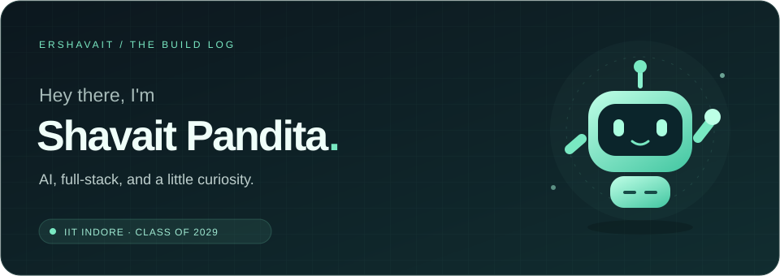

 

  

**Learning the internals. Building the useful.**

From training models to building the interfaces around them — I like connecting the pieces.

### A little about me

- 🎓 B.Tech in Civil Engineering at **IIT Indore**, class of **2029**.
- 🧠 Exploring **machine learning, language models, and full-stack development**.
- 🔬 Interested in how intelligent systems work, from transformer internals to practical applications.
- 🤝 Always up for a thoughtful conversation, an interesting problem, or a project worth building together.

### Things I've been building

| Project | Explore |
| :--- | :--- |
| **FlashGuard** | [Open the project →](https://github.com/ershavait/flashguard) |
| **Mini GPT** | [Open the project →](https://github.com/ershavait/cynaptics-mini-gpt) |
| **InterviewAI** | [Open the project →](https://github.com/ershavait/InterviewAI) |
| **English–Hindi Transformer** | [Open the project →](https://github.com/ershavait/en-hi-translator-transformer) |

### My toolkit

**Languages** &nbsp; Python · C++ · JavaScript · TypeScript · SQL  
**AI / ML** &nbsp; PyTorch · Scikit-learn · XGBoost · Transformers  
**GenAI** &nbsp; LLMs · RAG · LangGraph · Vector databases  
**Web** &nbsp; React · Node.js · Express · MongoDB · PostgreSQL  
**Tools** &nbsp; Git · Docker · Kafka · Redis · Pathway

<b>Beyond the code</b>

- Marketing Associate, **Code Rhythm 2027**.
- Previously Web Development Associate, **E-Summit 2026**.
- **JEE Advanced:** AIR 9560 · **IAT 2025:** AIR 1389.

### Small steps, steady commits

---

**Have something interesting in mind? [Let's talk.](mailto:ershavait@gmail.com)**  
Thanks for stopping by. There's always another idea taking shape.

